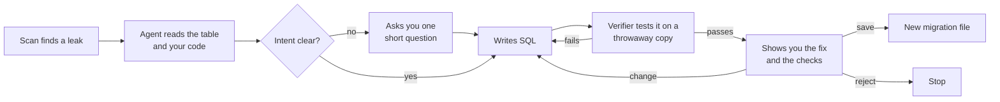

# Vibesecure

Find out who can read and change the data in your Supabase app, catch the common attacks hiding in its code, and fix the database with an AI agent that asks before it changes anything.

Built for apps made with Lovable, Bolt and other AI app builders, which often ship databases anyone can read. In 2025, 170+ Lovable apps leaked data through policies that let everyone in (CVE-2025-48757). In 2026, Moltbook exposed 1.5M API keys because row-level security was missing.

```text
$ npx vibesecure scan

Who can reach user A's data?
                        strangers   other users   owner
  author_stats (view)   R           R             R
  comments              ····        RA··          RA··
  notes                 RAED        RAED          RAED
  posts                 RAED        RAED          RAED
  todos                 ····        ····          RAED
  invoices (bucket)     ····        R···          RA··

  R read  A add  E edit  D delete  · blocked

Database
  CRITICAL Anyone on the internet can read, edit and delete other users' rows in posts,
           and add rows to posts in other users' names.
  CRITICAL Users can make themselves admin by setting profiles.role = 'admin' on their own row.
           Your access rules trust this column (is_admin()), so this unlocks other people's data too.
  CRITICAL search_posts() pastes "term" into a SQL query (SQL injection).
  ...

App code
  CRITICAL This payment webhook doesn't check the signature, so anyone can send it a fake
           "payment succeeded" event.
           supabase/functions/stripe-webhook/index.ts:13 · A08 Software and Data Integrity Failures
  HIGH     Renders HTML without sanitizing it (cross-site scripting): __html: html
           src/components/CommentBody.tsx:5 · A03 Injection
           Fix: Sanitize it first with DOMPurify: __html: DOMPurify.sanitize(html).
  HIGH     Anyone can call this function as often as they like and use your Lovable AI
           account (no login check, no rate limit).
           supabase/functions/ask-ai/index.ts:12 · A04 Insecure Design
  ...

17 findings: 5 critical · 6 high · 4 medium · 1 low · 1 info
```

## Quick start

Run it in the folder of your app (the one with `supabase/migrations/`):

```bash
npx vibesecure scan        # who can do what, plus the code checks (no AI, no API key)
npx vibesecure fix         # fix the database, approving every change
```

`fix` uses Claude when `ANTHROPIC_API_KEY` is set. Without a key, it uses fix templates and asks you who should read and write each table.

Nothing connects to your real database or your live site. Your migrations are loaded into an in-memory Postgres, your code is read but never run, and fixes are saved as new migration files for you to apply. An app without Supabase migrations still gets the code checks.

## How it works

### 1. Scan: real access tests, not pattern matching

1. Your migrations are loaded into [PGlite](https://pglite.dev), which is real Postgres compiled to WebAssembly and running inside Node. You don't need Docker or a database connection.
2. A small Supabase setup is added first: the `anon` and `authenticated` roles, `auth.uid()`, the `auth` and `storage` schemas, and Supabase's default grants.
3. Three fake users are created. **User A** gets a row in every table and a file in every bucket. **User B** is another signed-in user. **User C** is used to test adding rows.
4. Every table, view and bucket is tested the way a Supabase API request would run: inside a transaction, switched to the `anon` or `authenticated` role, with the JWT claims `auth.uid()` reads. Every test is rolled back.
5. The results become a table of who can do what, plus plain-English findings.
6. Columns like `role` and the database functions are checked too (see below). Your source files are read for common attacks, listed under [What it checks](#what-it-checks).

The owner of each row is worked out from the schema: a foreign key to `auth.users`, a key to a table whose id *is* the user's id (like `profiles`), or a column named like `user_id`.

### 2. Fix: an agent proposes, a verifier decides, you approve



The agent is a hand-written tool-use loop on the Claude API with five tools:

| Tool | What it does |
|---|---|
| `read_table` | Columns, owner column, policies, and the measured access |
| `find_usages` | Where your code calls `supabase.from("posts")`, with the `.eq("user_id", ...)` filters that show intent |
| `ask_human` | One multiple-choice question when intent is unclear, at most two per table |
| `test_fix` | Runs the SQL on a fresh copy of the database and returns which access rules pass or fail |
| `propose_fix` | Shows you the fix; you save it, ask for changes, or reject it |

**The verifier decides, not the model.** A fix is accepted only when all three of these hold:

- Strangers and other users are blocked where your intent says they should be.
- The owner keeps access.
- **No other table's access changed.**

Every step is written to `.vibesecure/trace.jsonl`.

### 3. Users promoting themselves

A policy like `using (auth.uid() = id)` on `profiles` looks right, but it lets people edit *every* column of their own row, including `role`. For each column like `role`, `is_admin`, `plan`, `subscription_tier` or `credits`, Vibesecure tests this for real:
- user A tries to set it to the strongest value (`'admin'`, `'pro'`, `true`, `1000`) on their own row;
- user C tries to add a new row with it already set.

The value is read back afterwards, so a trigger that quietly undoes the change counts as protection. So does a `with check` rule or a column grant.

The finding is critical when your policies or functions (like `is_admin()`) trust that column. `vibesecure fix` locks it the way [Supabase's docs](https://supabase.com/docs/guides/database/postgres/column-level-security) recommend:

```sql
revoke update on table public.profiles from anon, authenticated;
grant update (id, full_name, email, avatar_url, created_at) on table public.profiles to anon, authenticated;
```

It then checks on a throwaway copy that users can no longer set `role`, can still edit the rest of their row, and that nothing else changed.

### Guardrails

- A fix may only touch the table being fixed, and only with RLS, policy, grant and view-security statements. `drop table`, `delete`, new functions and anything else are refused, whoever wrote them. Grants are limited to `select`, `insert`, `update` and `delete`, the privileges the verifier tests.
- Nothing is written without your "yes". The agent never touches a real database.
- Templates and the agent keep your safe policies (like an admin rule) and drop only the ones that cause the leak. To find those, each policy is tested on its own.

## What it checks

The database checks run against a real Postgres. The code checks read your source files, including `.env` and `supabase/config.toml`, and never run them.

| OWASP Top 10 (2021) | Checks |
|---|---|
| A01 Broken Access Control | <ul><li>Tables with RLS off, `using (true)` policies, insert and update policies that don't check the owner, views that skip RLS, and storage buckets (all tested).</li><li>Users setting their own `role`, `plan` or `credits` (tested).</li><li>`security definer` functions anyone can call that change or return data without checking `auth.uid()`.</li><li>Open redirects (`?next=https://evil.example`).</li><li>Admin checks done only in the browser.</li></ul> |
| A02 Cryptographic Failures | <ul><li>Passwords kept in your own tables instead of Supabase Auth.</li><li>`Math.random()` used for tokens, invite codes or passwords.</li></ul> |
| A03 Injection | <ul><li>XSS: `dangerouslySetInnerHTML`, `innerHTML` and `document.write` with unsanitized values, and markdown rendered with `rehype-raw`.</li><li>SQL injection: `EXECUTE` with pasted-in arguments in database functions, and raw queries in server code.</li><li>Supabase `.or()` filter injection.</li><li>`eval`, and shell commands built from variables.</li></ul> |
| A04 Insecure Design | <ul><li>Rate limiting: server functions that call paid APIs (OpenAI, Anthropic, Gemini, Lovable AI, Resend, Twilio and others) with no login check or no rate limit, which lets bots run up your bill.</li><li>Tables anyone can add rows to (spam).</li><li>Admin or paid status read from `localStorage`.</li></ul> |
| A05 Security Misconfiguration | <ul><li>`security definer` functions without a fixed `search_path`.</li><li>CORS that echoes any origin with credentials.</li></ul> |
| A07 Identification and Authentication Failures | <ul><li>Service-role, Stripe, OpenAI and other keys in browser code or in `VITE_` / `NEXT_PUBLIC_` variables.</li><li>`.env` files git would commit.</li><li>Edge functions that use the service key without checking the caller.</li><li>JWTs decoded without verifying them.</li><li>Raised sign-in rate limits, short passwords, anonymous sign-ins and email confirmation in `supabase/config.toml`.</li></ul> |
| A08 Software and Data Integrity Failures | Payment webhooks (Stripe, Razorpay, Lemon Squeezy, PayPal, Paddle, Cashfree) that don't verify the signature. |
| A10 Server-Side Request Forgery | Server code that fetches a URL taken straight from the request. |

Some tables are unreachable from the API because Supabase stopped granting new tables automatically on Oct 30, 2026. Use `--no-default-grants` to check this.

Keys are never printed. Values from `.env` are hidden, and keys in code are cut to their first characters.

**Limits.** The code checks follow patterns, so they can miss things, and now and then they flag safe code. To silence one, add `// vibesecure-ignore` on that line or the line above. Not covered:
- vulnerable dependencies (A06; run `npm audit`);
- logging (A09);
- anything that needs your live site, which Vibesecure never contacts.

Database fixes are automatic. Code and database-function findings each come with a one-line fix to apply by hand.

## Options

```text
vibesecure scan [dir] [--json] [--fail-on critical|high|medium|low|none] [--schema name]
                      [--no-default-grants] [--skip-code]
vibesecure fix  [dir] [--no-ai] [--model id] [--effort low|medium|high|xhigh|max]
vibesecure fix  [dir] --table notes --read owner --write owner --yes   # no questions
vibesecure fix  [dir] --lock profiles.role --yes                      # stop users setting a column
```

`scan` exits with code 1 when it finds a problem at the `--fail-on` level or worse (default: `high`), so you can run it in CI:

```yaml
- run: npx vibesecure scan --fail-on high
```

## Development

```bash
npm install
npm test              # scan, database and code checks, fixes, verifier and the agent loop
npm run dev -- scan examples/leaky-app
npm run build
```

The agent tests drive the real loop with a scripted model and a scripted person, so they run without an API key.

```text
src/
  db/       load migrations into PGlite, Supabase shim, schema introspection
  scan/     seeding, access tests, privilege escalation, database functions, findings
  code/     source file checks: XSS, secrets, server functions, injection, config
  fix/      intent, templates, column locks, guard, verifier, migrations
  agent/    the tool-use loop, tools, prompt, trace
  ui/       terminal prompts and the report
examples/leaky-app/   a deliberately leaky Lovable-style app for demos and tests
test/fixtures/        small projects for the database checks
```

## License

MIT
