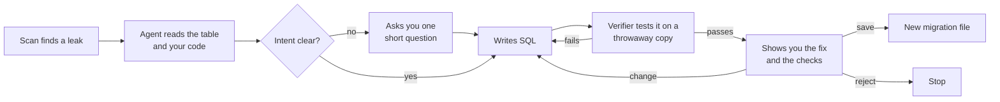

# Vibesecure

Find out who can read and change the data in your Supabase app, then fix it with an AI agent that asks before it changes anything.

Built for apps made with Lovable, Bolt and other AI app builders, which often ship databases anyone can read. In 2025, 170+ Lovable apps leaked data through policies that let everyone in (CVE-2025-48757). In 2026, Moltbook exposed 1.5M API keys because row-level security was missing.

```text
$ npx vibesecure scan

Who can reach user A's data?
                        strangers   other users   owner
  author_stats (view)   R           R             R
  comments              ····        RA··          RA··
  notes                 RAED        RAED          RAED
  posts                 RAED        RAED          RAED
  todos                 ····        ····          RAED
  invoices (bucket)     ····        R···          RA··

  R read  A add  E edit  D delete  · blocked

What we found
  CRITICAL Anyone on the internet can read, edit and delete other users' rows in posts,
           and add rows to posts in other users' names.
           RLS is turned off for this table.
  HIGH     Any signed-in user can read other users' rows in comments, and add rows
           to comments in other users' names.
  MEDIUM   Any signed-in user can list and read other users' files in the "invoices" bucket.
  ...
```

## Quick start

Run it in the folder of your app (the one with `supabase/migrations/`):

```bash
npx vibesecure scan        # who can do what, table by table (no AI, no API key)
npx vibesecure fix         # fix it, approving every change
```

`fix` uses Claude when `ANTHROPIC_API_KEY` is set. Without a key, it uses fix templates and asks you who should read and write each table.

Nothing connects to your real database. Your migrations are loaded into an in-memory Postgres, and fixes are saved as new migration files for you to apply.

## How it works

### 1. Scan: real access tests, not pattern matching

1. Your migrations are loaded into [PGlite](https://pglite.dev), which is real Postgres compiled to WebAssembly and running inside Node. You don't need Docker or a database connection.
2. A small Supabase setup is added first: the `anon` and `authenticated` roles, `auth.uid()`, the `auth` and `storage` schemas, and Supabase's default grants.
3. Three fake users are created. **User A** gets a row in every table and a file in every bucket. **User B** is another signed-in user. **User C** is used to test adding rows.
4. Every table, view and bucket is tested the way a Supabase API request would run: inside a transaction, switched to the `anon` or `authenticated` role, with the JWT claims `auth.uid()` reads. Every test is rolled back.
5. The results become a table of who can do what, plus plain-English findings.

The owner of each row is worked out from the schema: a foreign key to `auth.users`, a key to a table whose id *is* the user's id (like `profiles`), or a column named like `user_id`.

### 2. Fix: an agent proposes, a verifier decides, you approve



The agent is a hand-written tool-use loop on the Claude API with five tools:

| Tool | What it does |
|---|---|
| `read_table` | Columns, owner column, policies, and the measured access |
| `find_usages` | Where your code calls `supabase.from("posts")`, with the `.eq("user_id", ...)` filters that show intent |
| `ask_human` | One multiple-choice question when intent is unclear, at most two per table |
| `test_fix` | Runs the SQL on a fresh copy of the database and returns which access rules pass or fail |
| `propose_fix` | Shows you the fix; you save it, ask for changes, or reject it |

**The verifier decides, not the model.** A fix is accepted only when all three of these hold:

- Strangers and other users are blocked where your intent says they should be.
- The owner keeps access.
- **No other table's access changed.**

Every step is written to `.vibesecure/trace.jsonl`.

### Guardrails

- A fix may only touch the table being fixed, and only with RLS, policy, grant and view-security statements. `drop table`, `delete`, new functions and anything else are refused, whoever wrote them.
- Nothing is written without your "yes". The agent never touches a real database.
- Templates and the agent keep your safe policies (like an admin rule) and drop only the ones that cause the leak. To find those, each policy is tested on its own.

## What it checks

- Tables with RLS turned off.
- Policies that let everyone in (`using (true)`).
- Insert and update policies that don't check the owner (`with check`).
- Views that skip RLS because they run with their creator's rights (no `security_invoker`).
- Storage buckets, per bucket: who can list, upload, overwrite and delete other users' files.
- Tables the API can't reach at all, for Supabase's change on Oct 30, 2026, when new tables stopped getting API grants automatically. Use `--no-default-grants` to check this.

Not yet: edge functions, `security definer` functions callable by anyone, secrets in your frontend bundle, and column-level privilege escalation (a user setting their own `role` to `admin`).

## Options

```text
vibesecure scan [dir] [--json] [--fail-on critical|high|medium|low|none] [--schema name] [--no-default-grants]
vibesecure fix  [dir] [--no-ai] [--model id] [--effort low|medium|high|xhigh|max]
vibesecure fix  [dir] --table notes --read owner --write owner --yes   # no questions
```

`scan` exits with code 1 when it finds a problem at the `--fail-on` level or worse (default: `high`), so you can run it in CI:

```yaml
- run: npx vibesecure scan --fail-on high
```

## Development

```bash
npm install
npm test              # splitter, scan, extensions, fixes, verifier and the agent loop
npm run dev -- scan examples/leaky-app
npm run build
```

The agent tests drive the real loop with a scripted model and a scripted person, so they run without an API key.

```text
src/
  db/       load migrations into PGlite, Supabase shim, schema introspection
  scan/     seeding, access tests, findings
  fix/      intent, templates, guard, verifier, migrations
  agent/    the tool-use loop, tools, prompt, trace
  ui/       terminal prompts and the report
examples/leaky-app/   a deliberately leaky Lovable-style app for demos and tests
```

## License

MIT
